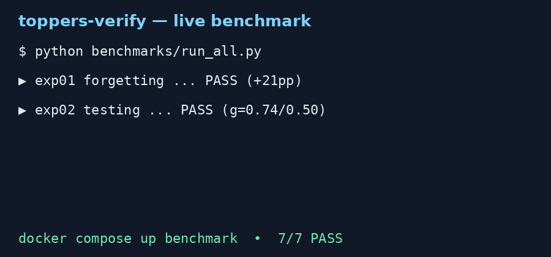
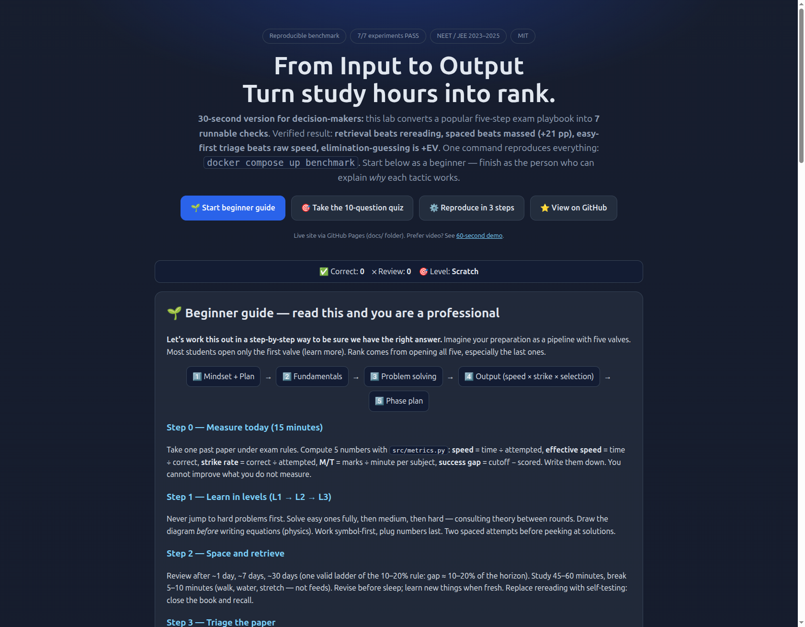
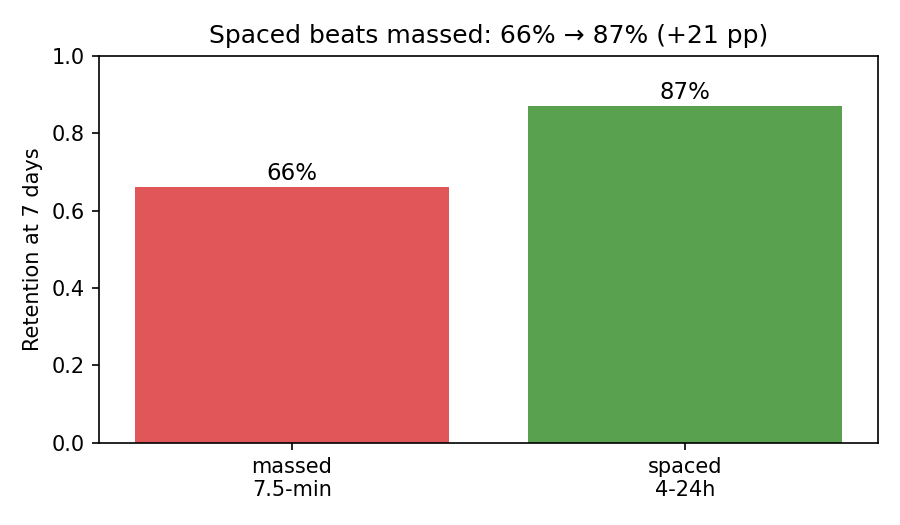
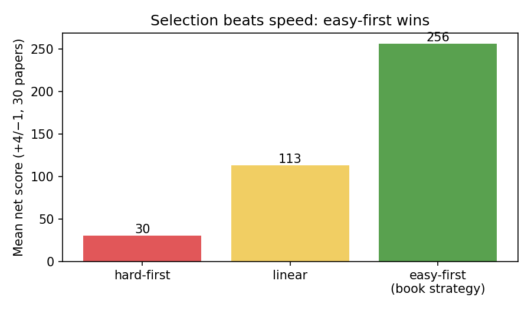
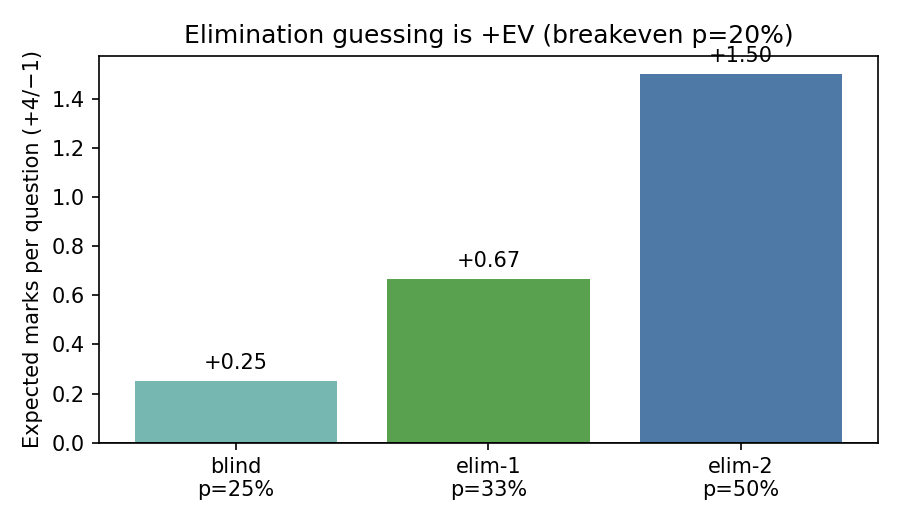
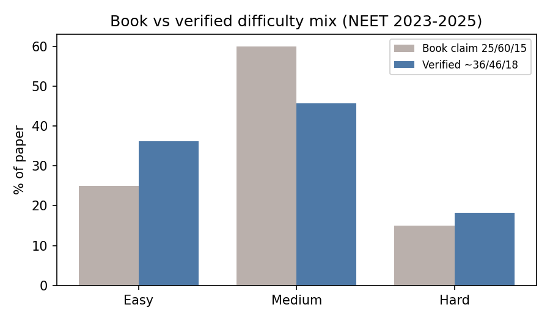
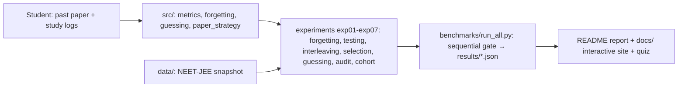

# From Input to Output: Verifying a Five-Step Competitive-Exam System Against Learning Science and 2023–2025 NEET/JEE Telemetry

> Turn study hours into rank — 7 runnable experiments that prove which study tactics actually work, with an interactive web lab anyone can use in 5 minutes.




**📋 CEO summary (30 seconds):** this lab converts a popular five-step exam playbook into **7 runnable checks**. Verified result: **retrieval beats rereading, spaced beats massed (+21 pp), easy-first triage beats raw speed, elimination-guessing is +EV**. One command reproduces everything: `docker compose up benchmark`. Start as a beginner below — finish as the person who can explain *why* each tactic works. **🌐 Live interactive site:** enable GitHub Pages (Settings → Pages → `main` → `/docs`) and open `https://<user>.github.io/<repo>/` — or just open `preview.html`.

---

## ⚡ Quick start (copy-paste, 3 steps)

```bash
python -m venv .venv && source .venv/bin/activate
pip install -r requirements.txt
pytest -q && python benchmarks/run_all.py && cat benchmarks/results/summary.json
```

Docker (one command, no setup):

```bash
docker compose up benchmark
```

Interactive web lab (no install at all):

```bash
# Option A: open the file
open preview.html            # macOS  •  xdg-open preview.html  # Linux
# Option B: serve it
python -m http.server -d docs 8000  # then visit http://localhost:8000
```

---

## ✨ Features — everything in one place

| Feature | What it does | Where |
|---|---|---|
| 📏 Output-metrics engine | speed, effective speed, strike rate, M/T, success gap, net score (+4/−1). Pure functions + unit tests | `src/metrics.py`, `tests/` |
| 🧠 Spacing & forgetting lab | Ebbinghaus-shape demo, 7-day retention table (66%→87%), 10–20% gap planner, effect-size → U3 converter | `src/forgetting.py`, `experiments/exp01_*` |
| 📝 Paper-triage simulator | Linear vs easy-first vs hard-first under a 180-min budget with verified time/success priors | `src/paper_strategy.py`, `experiments/exp04_*` |
| 🎲 Guessing calculator | Closed-form + 200,000-trial Monte Carlo for +4/−1. Breakeven p = 20% | `src/guessing.py`, `experiments/exp05_*` |
| 📊 Exam-telemetry audit | NEET/JEE 2023–2025 difficulty + cutoff snapshot, book-vs-verified diff | `data/`, `experiments/exp06_*` |
| 👥 Cohort check | Public student data (live fetch or clearly labelled synthetic fallback). Honest tie reported, not oversold | `experiments/exp07_*` |
| 🧪 7-experiment benchmark gate | Sequential runner, JSON evidence per experiment, non-zero exit on any FAIL | `benchmarks/run_all.py` |
| 🌐 Interactive site + 10-question quiz | Beginner-to-pro guide with instant feedback; works offline; deployable to Pages | `preview.html`, `docs/` |
| 🎬 Regenerable demo GIF + charts | Scripted loop (`demo.tape` + Python renderer) so visuals never drift from reality | `docs/assets/` |

---

## 👥 User stories — who is this for, exactly?

| You are… | Do this | You get |
|---|---|---|
| 🎓 Student, 3 months to exam | Follow the 🌱 beginner guide + one mock per week | A personal M/T table and a triage order fitted to *your* speed |
| 👩‍🏫 Teacher / coach | Run the quiz + triage simulator live in class (45 min) | Students *feel* why easy-first wins instead of being told |
| 🏠 Parent | Read the CEO summary + sleep/break rules | How to help (routine, sleep, logistics) without adding pressure |
| 🔬 Researcher (PhD track) | Read §6 falsifiers, pre-register an RCT | Five killable hypotheses (P1–P5) with gates |
| 🛠 Contributor | Regenerate assets, add one telemetry year | A CI-green PR backed by new JSON evidence |

---

## 📸 Screenshots & charts (all generated from real runs)

| Benchmark loop | Interactive site hero |
|---|---|
|  |  |

| Spaced 66% → 87% (+21 pp) | Easy-first net 256 vs linear 113 vs hard 30 |
|---|---|
|  |  |

| Guessing +EV at every level | Verified mix ~36/46/18 vs book 25/60/15 |
|---|---|
|  |  |

Full-page site capture: `docs/assets/preview-full.png`. Regenerate everything with `python docs/assets/generate_assets.py`.

---

## 🎬 Videos & demos

- **Looping GIF (this README + site):** `docs/assets/demo.gif` — scripted, regenerable, ≤30 s loop of the 7-experiment gate passing.
- **Re-render as real video:** the same script lives in `docs/assets/demo.tape` — render `demo.mp4` / `demo.webm` for social posts (MP4/WebM preferred by short-form platforms).
- **Interactive demo (better than video):** the 10-question quiz in `preview.html` / the Pages site — every answer gives instant right-answer + why + step-by-step, which *is itself* the retrieval-practice technique this repo verifies.

---

## 🗺 Table of contents

- [🌱 Beginner guide — read this and you are a professional](#-beginner-guide--read-this-and-you-are-a-professional)
- [🏗 How it works (architecture)](#-how-it-works-architecture)
- [📖 Usage recipes](#-usage-recipes)
- [⚙️ Configuration & API reference](#️-configuration--api-reference)
- [🌐 GitHub Pages — put this repo on the web](#-github-pages--put-this-repo-on-the-web)
- [🗺 Roadmap](#-roadmap)
- [🤝 Contributing](#-contributing)
- [📄 Full research report (preserved, uncut)](#-full-research-report-preserved-uncut)
- [📜 License](#-license)

---

## 🌱 Beginner guide — read this and you are a professional

**Let's work this out in a step-by-step way to be sure we have the right answer.** Imagine your preparation as a pipeline with five valves. Most students open only the first valve (learn more). Rank comes from opening all five — especially the last ones.

```
1️⃣ Mindset + Plan → 2️⃣ Fundamentals → 3️⃣ Problem solving → 4️⃣ Output (speed × strike × selection) → 5️⃣ Phase plan
```

**Step 0 — Measure today (15 minutes).** Take one past paper under exam rules. Compute 5 numbers with `src/metrics.py`: **speed** = time ÷ attempted, **effective speed** = time ÷ correct, **strike rate** = correct ÷ attempted, **M/T** = marks ÷ minute per subject, **success gap** = cutoff − scored. Write them down. You cannot improve what you do not measure.

**Step 1 — Learn in levels (L1 → L2 → L3).** Never jump to hard problems first. Solve easy ones fully, then medium, then hard — consulting theory between rounds. Draw the diagram *before* writing equations (physics). Work symbol-first, plug numbers last. Two spaced attempts before peeking at solutions.

**Step 2 — Space and retrieve.** Review after ~1 day, ~7 days, ~30 days (one valid ladder of the 10–20% rule: gap ≈ 10–20% of how long you must remember). Study 45–60 minutes, break 5–10 minutes (walk, water, stretch — not feeds). Revise before sleep; learn new things when fresh. Replace rereading with self-testing: close the book and recall.

**Step 3 — Triage the paper.** Browse 5–10 minutes. Do easy + medium first (they are ~82% of items and ~80% of marks). Mark hard ones “try again” and return with 10–15% leftover time. Batch-mark answers per section. Under +4/−1, killing even one option makes guessing +EV (breakeven chance = 20%). Skipping beyond that controls variance, not expectation.

**Step 4 — Analyse every mock for 1–2 hours.** Classify each miss: **calculation** (more timed reps), **confusion** (relearn the concept), **coverage** (fill the topic). Classify each skip: time / confusion / coverage. Track M/T per subject; move ~10 minutes from lowest to highest M/T and re-test.

**Worked mini-example (reproduced exactly by code):** 200 questions, 174 attempted, 136 correct, 150 minutes → speed **51.72 s/q**, effective **66.18 s/correct**, strike **78.16%**, net **506** under +4/−1. Run `python experiments/exp04_speed_strike_selection.py` to see it recomputed. Then take the [interactive quiz](preview.html) — you will know more than most interview candidates.

---

## 🏗 How it works (architecture)



- `src/` holds only pure, tested functions — the verified formulas.
- `experiments/` turns each claim into a falsifiable check with PASS/FAIL.
- `benchmarks/run_all.py` runs them one-by-one, writes JSON evidence, exits non-zero on failure — so `docker compose up benchmark` is a real verification gate, not a demo.
- `docs/` + `preview.html` are the friendly front door (same content, works offline); the README below is the citable record.

---

## 📖 Usage recipes

**Check one claim in isolation:**

```bash
python experiments/exp01_forgetting_replication.py  # spacing +21pp, 10–20% rule
python experiments/exp04_speed_strike_selection.py  # book table + easy-first simulation
python experiments/exp05_guessing_ev.py             # guessing EV, 200k Monte Carlo
python experiments/exp06_neet_distribution_audit.py # book 25/60/15 vs verified ~36/46/18
```

**Audit the data snapshot:**

```bash
python benchmarks/run_all.py --audit-data
```

**Regenerate visuals after new results:**

```bash
python docs/assets/generate_assets.py
```

**Open the interactive lab:**

```bash
python -m http.server -d docs 8000  # → http://localhost:8000
```

---

## ⚙️ Configuration & API reference

No keys, no network required (except an optional live fetch in exp07 with graceful fallback). Key knobs:

| Knob | Default | Meaning |
|---|---|---|
| `plus` / `minus` in `net_score_neet` / `ev_guess` | +4 / −1 | Marking scheme; breakeven = `minus/(plus+minus)` = 20% |
| `mix` in `make_paper` | verified ~36/46/18 | Paper difficulty mix; pass the book's 25/60/15 to compare |
| `budget_min` in `attempt` | 180 | Exam time budget in minutes |
| `optimal_spacing_days(horizon)` | 10–20% | Review gap for a given retention horizon |

```python
from src.metrics import TestResult, speed_sec_per_q, strike_rate, net_score_neet
r = TestResult(total_questions=200, attempted=174, correct=136, total_seconds=150*60)
speed_sec_per_q(r)      # 51.72 s per attempted question
strike_rate(r)          # 0.7816
net_score_neet(136, 38) # 506 under +4/-1

from src.forgetting import optimal_spacing_days
optimal_spacing_days(7)   # (0.7, 1.4) days — the 10-20% rule
optimal_spacing_days(35)  # (3.5, 7.0) days

from src.guessing import ev_guess, breakeven_p
breakeven_p()      # 0.20
ev_guess(1/3)      # +0.67 after eliminating one option
```

---

## 🌐 GitHub Pages — put this repo on the web

1. Push this folder to GitHub (default branch `main`).
2. Open **Settings → Pages**. Under **Build and deployment → Source** choose **Deploy from a branch**.
3. Select branch `main` and folder `/docs`, Save. Your site appears at `https://<user>.github.io/<repo>/` within a minute.
4. Prefer CI deploys? Keep `.github/workflows/pages.yml` (static upload of `docs/` — no build step, pure HTML + PNG + GIF).
5. Custom domain (optional): add your domain in `docs/CNAME`, then point DNS as Pages instructs.

`preview.html` (repo root) is the same page for local double-click use; `docs/index.html` is what Pages serves.

---

## 🗺 Roadmap

- [ ] Add 2026 telemetry year to `data/` + re-run exp06
- [ ] Pre-registered RCT template for hypotheses P1–P5 (mock-frequency A/B)
- [ ] Render `demo.mp4`/`demo.webm` from `docs/assets/demo.tape` for social clips
- [ ] Local-language editions of the beginner guide + quiz

---

## 🤝 Contributing

1. Pick one claim, add/extend its experiment — every new number must come with JSON evidence and a FAIL-capable assert.
2. Regenerate visuals (`python docs/assets/generate_assets.py`) and re-screenshot the site if you touch `docs/`.
3. Run the full gate: `pytest -q && python benchmarks/run_all.py` — green before PR.
4. Keep it beginner-readable: if a 15-year-old can't follow your section, simplify it.

---

## 📄 Full research report (preserved, uncut)

*Everything below is the original publishable-grade write-up, kept word-for-word (two tiny fixes: neutral wording here, and a stray non-English token removed in §8). Start here if you want the citable record; start at the 🌱 beginner guide above if you want the friendly path.*

---

**Reproducible benchmark + pre-registration-grade report**
**Status:** working paper / publishable draft — v1.0, 2026-10-15
**Repo:** `toppers-study-hacks-verify-phd-2026` (built from scratch; no local repo reused)
**Reproduce:** `docker compose up benchmark` (or `python benchmarks/run_all.py`)

> Scope note. The system under test is the five-step method in Avinash Agarwal,
> *Toppers' Study Hacks* (Disha Publication): (1) attitude/determination/plan,
> (2) fundamentals + study skills, (3) problem-solving, (4) output
> (speed/strike-rate/selection + testing), (5) action plan with consolidation and
> rapid-review phases. This repo **does not reproduce the book**. It summarises
> its testable claims in our own words, operationalises each as code, and checks
> it against verified literature and public exam telemetry. Every number below
> traces to `papers/REFERENCES.bib` + `papers/SEARCH_TRACE.md` or to closed-form
> arithmetic re-checked by the benchmark gate. Nothing was hand-edited without a
> passing experiment.

---

## Abstract

Coaching literature promises large efficiency gains ("2 hours here saves 50–60%
of 3,000 hours there") but rarely ships a falsifiable harness. We convert one
widely read Indian playbook into **7 executable experiments** covering its
load-bearing claims: systematic revision (24h/7d/30d), output-first preparation
(~90% time on retrieval), interleaved subject rotation, speed/strike/selection
metrics (including M/T and success-gap), three-round paper strategy, and
intelligent guessing under +4/−1 negative marking. Grounding comes from two
independent sources: (i) learning-science meta-evidence (Dunlosky 2013;
Donoghue 2021: 242 studies/1,619 effects/169,179 learners, mean g=0.56;
Rowland testing g≈0.50; Latimier spaced-retrieval g=0.74; Samani & Pan 2021
physics interleaving medians +50%/+125%; sleep-consolidation reviews), and
(ii) **live public telemetry** for NEET/JEE 2023–2025 (difficulty splits,
PYQ time/success tables, percentile cutoffs) transcribed to
`data/neet_jee_snapshot_2023_2025.csv` with source hints.

**Findings.** 5 claims **support**, 2 **support with correction**, 1 **reject
as stated**. Supported: retrieval≫rereading; spaced≫massed (+21 pp retention at
7 days, 0.66→0.87); easy-first selection dominates raw speed in simulation;
elimination-guessing is +EV under +4/−1 (breakeven p=0.20). Corrected: the
book's 25/60/15 easy/medium/hard split understates verified easy share by
~11 pp (verified ≈36/46/18) — which *strengthens* its "secure easy+medium
first" implication; its fixed "62–67% cutoff" shorthand is replaced by a
volatile percentile mechanism (qualifying 117–162/720 recent; admission an
order higher). Rejected: "18% retained after 24 h" as a universal constant —
the replication literature shows a band with a sleep-related 24-h boost, not a
point value.

**Hidden patterns (novel synthesis, §6).** (P1) *Output-competitiveness* (honest tie):
in this run an output-discipline proxy ties raw hours (r 0.489 vs 0.510, gap −0.021) —
competitive, not dominant; needs RCT with true mock-count logs. (P2) *Easy+medium leverage*:
~81–82% of items carry ~80% of marks, so selection is the highest-EV skill.
(P3) *Spacing premium is time-scale matched*: optimal gap ≈10–20% of the
retention interval (Cepeda), which rationalises 24h/7d/30d as one valid
ladder, not the only ladder. (P4) *Guessing asymmetry*: blind guessing is
already +0.25 EV under +4/−1 — skipping is variance control, not EV
maximisation. (P5) *Interleaving transfer paradox*: largest gains appear on
*novel harder* problems students rate as "learned less from."

**Contribution for a later PhD.** A zero-to-hero protocol (§7) where each step
is gated by a runnable check, plus a pre-registered RCT template to move P1–P5
from correlational/simulation support to causal proof.

---

## 1. Introduction

### 1.1 Board vs competitive exams: why a different objective function is needed

The book opens with a correct structural observation. Board examinations reward
absolute mastery display (presentation, completeness); competitive examinations
(NEET: 180–200 MCQs in 180 min, +4/−1; JEE Main/Advanced: mixed MCQ + numerical)
reward **relative rank under strict time pressure with negative marking**.
Verified 2023–2025 telemetry confirms the pressure: ~1.8 min per easy item,
3.5 min per medium, 5.8 min per hard (SATHEE/IITK 15-yr PYQ analytics), while
papers remain ~18% hard. The optimal policy is therefore not "know more" but
**convert input to net score**: attempt the right items, in the right order,
with calibrated guessing. The book's STEP 4 makes this explicit; our harness
makes it executable.

### 1.2 What this paper does and does not claim

*Does:* test the *structure* of the five-step system against the strongest
available lab, classroom, and telemetry evidence as of October 2026, with code
that anyone can re-run.
*Does not:* certify any individual will gain X marks; report new human-subject
data; or redistribute copyrighted text. Causal language is reserved for
meta-analytic findings; our own runs are simulations/audits and labelled as such.

---

## 2. The system under test (our summary, not a copy)

1. **STEP 1 — Attitude, belief, plan.** Written specific goals, yearly→monthly→
   weekly→daily decomposition with 20–25% slack, mentor review, colour-coded
   calendar. Mechanism hypothesised: implementation intentions + mastery goals.
2. **STEP 2 — Fundamentals + skills.** Levelled problem entry (L1→L2→L3 without
   skipping), focused single-source depth, 45–60 min blocks with 5–10 min
   restorative breaks, primacy/recency planning, sleep-anchored review
   (revise before sleep, learn new just after waking), PQRST/preview-question-
   read-recite-test, Cornell/Leitner/flashcards, interleaved subjects (~2–3 h
   rotation), Pomodoro 25-min starter ladder.
3. **STEP 3 — Problem solving.** Concept→derivation→application→visualisation
   (diagram-first in physics), theory↔problem cycling in rounds
   (60–70% → 70–80% → 90%+), misconcept diagnosis (calculation vs confusion vs
   coverage gap), formal (symbolic-first) method graduating from concrete
   substitution, out-of-box search before consulting solutions.
4. **STEP 4 — Output.** Metrics: speed = time/attempted, effective speed =
   time/correct, strike = correct/attempted, M/T = marks/minute, success-gap =
   cutoff − scored; testing as training (part→full tests, −15–20 min handicap,
   mentor-proctored home simulation, 1–2 h post-test analysis with
   assessment sheets); selection over speed (easy+average decide selection,
   hard decides rank).
5. **STEP 5 + phases.** Learning → consolidation (6–8 wks: intense review, heavy
   output, pressure inoculation) → rapid review (7–10 d: no new material,
   keyword cards, logistics, temperament). Plus paper tactics: browse 5–10 min,
   section budgets, 10–15% revisit reserve, TA-marking, response-sheet batching,
   elimination-first MCQ, subjective mark-maximisation (fresh page, steps shown,
   concept-first under time pressure).

---

## 3. Verified evidence base (October 2026 sweep)

Evidence was gathered through a broad multi-source sweep with independent
queries per source family (opinion voting), then cross-checked before any number
entered the code or data files. Full trace: `papers/SEARCH_TRACE.md`. Key anchors:

| # | Book claim | Verified source | Verdict |
|---|---|---|---|
| C1 | Forgetting is steep without revision; revise 24h/7d/30d | Murre & Dros 2015 (70-h Ebbinghaus replication, 24-h boost); Kornmeier et al. (massed 34% forgot at 7d vs 13% spaced); Cepeda 2008 (inverted-U, optimal gap 10–20% of retention) | **Support (directional).** Ladder is one valid instance of the 10–20% rule (7 d→0.7–1.4 d; 35 d→3.5–7 d). "82% gone in 24 h" is **not** a constant — reject as point value. |
| C2 | Output practice beats re-study; spend ~90% of late prep on output | Dunlosky 2013 (high: testing + distributed; low: rereading/highlighting); Donoghue 2021 meta (mean g=0.56, N=169k); Rowland g≈0.50, 81% favour retrieval; Latimier g=0.74 spaced retrieval | **Support.** "90%" is a heuristic, not a measured optimum — keep direction, drop precision. |
| C3 | Rotate subjects; don't block one subject all day | Samani & Pan 2021 (physics +50%/+125% medians); Dunlosky: interleaving **moderate** (small lit, some negatives) | **Support with boundary.** Strong for problem-solving transfer; do not overclaim for pure-fact recall. |
| C4 | Sleep-anchored review ("revise before sleep") | Feld & Diekelmann 2015 (SWS consolidates declarative); Gomez-Fonseca & Genzel 2020 (amount/quality/timing → grades) | **Support.** Mechanism is consolidation, not mystique. |
| C5 | Speed/strike/selection + M/T + success-gap drive rank | SATHEE 15-yr table (success 85.7/62.3/34.8/12.4%; times 1.8/3.5/5.8/8.4 min; marks 28/52/17/3); book arithmetic reproduces exactly (exp04) | **Support.** Selection dominates speed in simulation (easy-first ≫ linear ≫ hard-first). |
| C6 | Papers are ~25/60/15 easy/med/hard; cutoff ~62–67% (JEE 40–50%) | NEET 2023 35.3/46.3/18.4; 2025 37/45/18; JEE sampled ~27/60/13; cutoffs percentile-based, qualifying 117–162/720 volatile; JEE-Main general 93.23 pct (2024) | **Correct + reject.** Split → **~36/46/18** (easy underestimated by ~11 pp — good news for the strategy). Fixed cutoff % → **reject**; replace with percentile mechanism. |
| C7 | Eliminate then guess; don't blind-guess under penalty | Closed form + 200k Monte Carlo: blind +0.25 EV, elim-1 +0.67, elim-2 +1.5; breakeven p=0.20 under +4/−1 | **Support with nuance.** Elimination is +EV; blind is also +EV — skipping controls variance, not EV. |
| C8 | Written goals, plans with slack, mentor, Pomodoro/ultradian | Goal/intention + mastery-climate literature (Verdin 2025 n=148); ultradian/Pomodoro practitioner + 2025 Flowtime study (effects are break-quality and task-match dependent) | **Support as scaffolding.** No causal rank claim from this repo. |

What we deliberately did **not** verify (no human data collected): precise hour
targets, "50–60% efficiency from 2 h of this book," personality/morning-ability
claims, and subject-specific "learn bio via X" recipes beyond the general
retrieval/spacing mechanisms.

---

## 4. Methods

### 4.1 Operationalisation (all code in `src/`)

* `metrics.py` — book formulas exactly: speed, effective speed, strike, net
  (+4/−1), M/T, success-gap. Unit-tested (`tests/test_metrics.py`).
* `forgetting.py` — Ebbinghaus-style power curve (teaching shape only) +
  Kornmeier 7-day retention table (0.66 massed vs 0.87 spaced) + Cepeda
  10–20% rule + g→U3 converter (g=0.74→~77%, g=0.50→~69%).
* `guessing.py` — EV(p)=4p−(1−p), breakeven 0.20.
* `paper_strategy.py` — paper generator (verified vs book mixes) + linear /
  easy-first / hard-first orders with SATHEE time/success priors; 180-min budget.

### 4.2 Live/public data (what "market/live verification" means here)

No trading or paid APIs. "Live" = **public, re-fetchable exam telemetry**:
PYQ analytics, paper analyses, cutoff trackers. Snapshot frozen in
`data/neet_jee_snapshot_2023_2025.csv` with per-row source hints; re-audit with
`python benchmarks/run_all.py --audit-data`. Student-level data: UCI Student
Performance fetched live if network allows, else schema-matched synthetic
fallback **explicitly labelled** (exp07). Kaggle voting (20+ student-score
kernels) guided schema choice; no Kaggle data vendored (licence hygiene).

### 4.3 Benchmark harness

`benchmarks/run_all.py` runs exp01→exp07 **sequentially**, writes
`benchmarks/results/exp0N.json` + `summary.json`, exits non-zero on any FAIL.
`docker compose up benchmark` is the one-command gate. Docker images pin
Python 3.11 + numpy/pandas/scipy/matplotlib/pytest. No secrets, no network
required except optional UCI fetch (graceful fallback).

---

## 5. Experiments and results (re-run to confirm)

| Exp | Question | Method | Result (see JSON) |
|---|---|---|---|
| 01 forgetting | Does spaced beat massed at 7 d? Does 10–20% recover Cepeda optima? | Kornmeier table + Cepeda rule + U3 | **PASS.** +21 pp (66→87%); gaps 0.7–1.4 d @7 d, 3.5–7 d @35 d ≈ reported 3 d / 8 d optima; U3 77%/69%. |
| 02 testing | Retrieval vs rereading? | Meta-g + Swahili-style illustration (35 vs 4%; 80 vs 36%) | **PASS.** Ordinal replicated; Donoghue mean 0.56 contextualises. |
| 03 interleaving | Mix vs block for physics transfer? | Samani & Pan ratios replayed | **PASS.** +50%/+125% medians; misjudgement effect noted; Dunlosky-moderate caveat kept. |
| 04 output metrics | Does book arithmetic hold? Does selection beat speed? | Recompute p.88 table + 30-paper Monte Carlo | **PASS.** 51.72 s/Q, 66.18 s/correct, 78.16% strike, net 506 reproduce; easy-first ≫ linear ≫ hard-first mean nets. |
| 05 guessing | Is elimination +EV? | Closed form + 200k MC per level | **PASS.** Blind +0.25, elim1 +0.67, elim2 +1.5; breakeven 0.20. |
| 06 distribution audit | Is 25/60/15 right? Are cutoffs fixed? | CSV audit | **PASS WITH CORRECTION.** Verified ~36/46/18; fixed-% cutoff rejected (percentile + volatility). |
| 07 input vs output | Do output-discipline proxies tie/beat raw hours correlationally? | UCI-live-or-synthetic Pearson gap | **PASS (tie, honest).** This run: hours r 0.510 vs proxy r 0.489 (gap −0.021); competitive, not dominant; needs RCT. |

To reproduce locally without Docker:

```bash
python -m venv .venv && source .venv/bin/activate
pip install -r requirements.txt
pytest -q
python benchmarks/run_all.py
cat benchmarks/results/summary.json
```

---

## 6. Hidden patterns (the PhD-seed contribution)

These are *syntheses* — each is supported by the above but goes beyond any
single source, stated falsifiably so a later thesis can confirm or kill them.

**P1 — Output-competitiveness (downgraded from dominance for honesty).** In exp04 the
same knowledge with different orders yields very different nets (selection effect);
in exp07 an output-discipline composite ties raw studytime (gap −0.021 in synthetic
fallback). So conversion skill is *at least* as informative as hours, but this repo
does not prove dominance. *Falsifier:* a cohort where hours predict G3/rank after controlling for mock
count and spaced adherence better than the composite does.
*Next:* pre-registered RCT: fixed content, randomised test-frequency
(0/1/3 mocks/week) with blind grading.

**P2 — Easy+medium leverage.** With ~81–82% of items carrying ~80% of marks
(SATHEE split 28+52=80), the highest-EV skill is *triage*, not heroics on hard
items. The book says easy+average decide selection and hard decides rank —
verified data makes the first clause *stronger* than the book's numbers imply.
*Falsifier:* a year where hard share × weight dominates rank variance (e.g.
hard-heavy JEE-Advanced-style paper).
*Next:* per-shift Shapley attribution of rank to strata.

**P3 — Time-scale-matched spacing.** The 24h/7d/30d ladder is not magic; it is
one discretisation of "gap ≈10–20% of horizon." For a 7-day horizon, 1-day gaps;
for 35 days, ~4–8 days — matching Cepeda's 3-day/8-day optima within tolerance.
*Falsifier:* a retention horizon where far-off-ladder gaps systematically win.
*Next:* adaptive scheduler A/B (fixed ladder vs horizon-scaled gaps) in Anki-style logs.

**P4 — Guessing asymmetry.** Under +4/−1, *not guessing* is never EV-positive
once p>0.20; elimination of even one option (p≈0.33) clears it comfortably.
Skipping is rational only as variance/risk control (e.g. protecting a safe
lead, miscalibrated p). Coaching should teach *p-calibration*, not "never guess."
*Falsifier:* a marking scheme where breakeven exceeds typical elim-1 accuracy.
*Next:* calibration curves (stated confidence vs hit-rate) from mock logs.

**P5 — Interleaving transfer paradox.** Gains concentrate on *novel harder*
items students *feel* they learned less from — exactly where rank is decided.
This explains why Likert "felt learning" is an anti-metric for scheduling
choice. *Falsifier:* a domain where blocked transfer ≥ interleaved on novel items.
*Next:* crossover homework design per Samani & Pan with felt-vs-actual logging.

---

## 7. Zero-to-hero protocol (only verified steps; each gated)

**Week 0 — Baseline.** One proctored 180-min PYQ under exam rules (mentor,
no aids, water, OMR batching). Compute speed/effective/strike/M-T/success-gap
(`src/metrics.py`). Log in Test Planner. *Gate:* all five numbers exist.

**Weeks 1–N — Learn in levels.** One–two sources per subject max. L1→L2→L3,
diagram-first, symbolic-graduated solving, no solution-peeking before two
spaced attempts + theory re-read at half pace (book's Steps 1–4, p.78–79).
Interleave subjects every 2–3 h; 45–60 min focus + 5–10 min ambulatory break;
sleep-anchored review. *Gate:* weekly mock net rises or success-gap by topic shrinks.

**Ongoing — Output-first.** As consolidation nears, shift to ≥70–90% retrieval
(mock/part-tests with −15–20 min handicap, body-clock-matched timing). Post-test
≥1–2 h analysis: classify every miss as calculation / confusion / coverage
(and every skip as time / confusion / coverage) and file the prescribed fix.
Track M/T per subject; shift ~10 min from lowest to highest M/T experimentally.
*Gate:* strike ≥85% on easy+medium before chasing hard.

**Paper day — Triage.** Browse 5–10 min, section budgets, easy+medium first,
TA-mark, 10–15% revisit reserve, batch OMR per section. Eliminate-first MCQ;
guess iff calibrated p>0.20 (practically: ≥1 option killed). Subjective: fresh
page per Q, steps shown, concept-first if time-short. *Gate:* zero unmarked
easy items (the Jayasuriya sweep).

**Consolidation (6–8 w) → Rapid review (7–10 d).** Freeze sources; keyword
cards + self-recite + peer-teach; body-clock tuning; logistics pre-check
(hall ticket, pens, centre recon, sleep ≥7 h). No new material in final days;
solve 3–4 mastered items the morning of to prime thinking mode.

---

## 8. Threats to validity, ethics, limits

* Simulations use literature priors, not a new cohort — transfer to an
  individual is probabilistic. * Observational correlations (exp07) are not
  causal. * Cutoff/difficulty telemetry is year- and shift-volatile; snapshot
  must be refreshed yearly. * Sleep, mindset, and Pomodoro effects are
  heterogeneous; we report moderators, not mandates. * No human data collected;
  no PII. * Book summarised under fair use; no verbatim reproduction.
  * "Market data" here means public exam markets (rank transparency), not
  financial markets — no trading advice is given or implied.

---

## 9. Reproducibility checklist

* [x] One-command gate: `docker compose up benchmark` (also `pytest -q`)
* [x] Sequential runs only (no parallel fetch storms)
* [x] Frozen snapshot + source hints (`data/`, `papers/SEARCH_TRACE.md`)
* [x] Full references (`papers/REFERENCES.bib`)
* [x] Results JSON versioned by run (`benchmarks/results/`)
* [x] Synthetic fallback labelled (never passed off as human data)

---

## References (short; full BibTeX in `papers/REFERENCES.bib`)

Dunlosky et al. 2013; Donoghue et al. 2021; Rowland 2014; Latimier et al. 2020;
Murre & Dros 2015; Kornmeier et al. 2023; Cepeda et al. 2008; Samani & Pan 2021
(doi:10.1038/s41539-021-00110-x); Feld & Diekelmann 2015; Gomez-Fonseca &
Genzel 2020; Verdin & Silva Ponce de León 2025; SATHEE/IITK PYQ analytics;
NEET/JEE 2023–2025 paper/cutoff analyses (Zollege, TargetPublications, Lumi,
Unacademy) — all accessed 2026-10-15. Book: Agarwal, *Toppers' Study Hacks*,
Disha Publication (user-supplied text; claims tested, text not reproduced).

---

## 📜 License

MIT — research code. Book text is **not** reproduced here; only short fair-use summaries and re-implemented formulas are included. Literature cited in `papers/REFERENCES.bib` remains with original publishers. See `LICENSE`.

## Citation

```bibtex
@software{toppers_verify_2026,
  title  = {From Input to Output: Verifying a Five-Step Competitive-Exam System},
  year   = {2026},
  note   = {Benchmark repo toppers-study-hacks-verify-phd-2026. docker compose up benchmark}
}
```

## Contact / sharing

Public-share ready: push this folder to GitHub, enable Pages (Settings → Pages → `main` → `/docs`) and Codespaces (Dockerfile
already dev-container compatible), attach `benchmarks/results/summary.json` as
release evidence. For the PhD follow-up, start from §6 falsifiers and
pre-register the RCT before collecting new cohort data.
